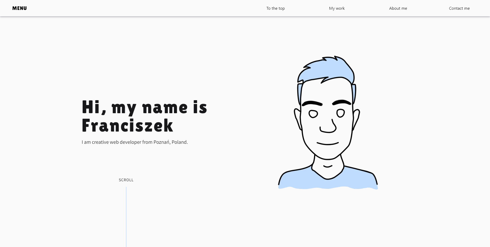
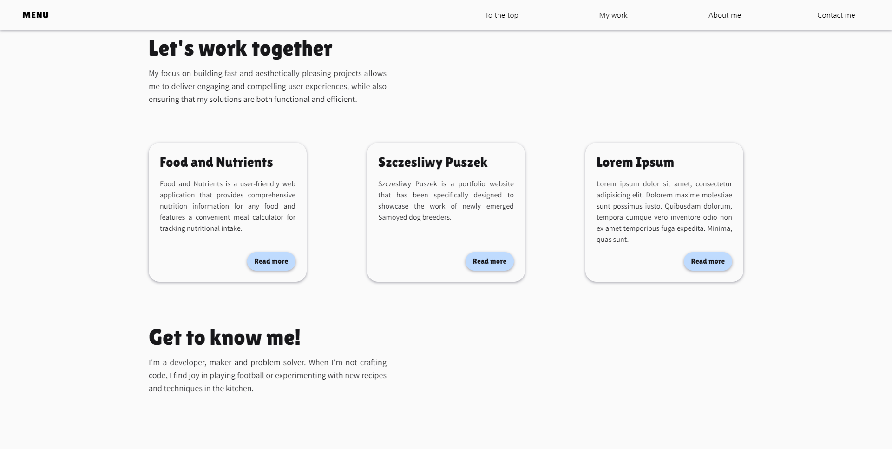
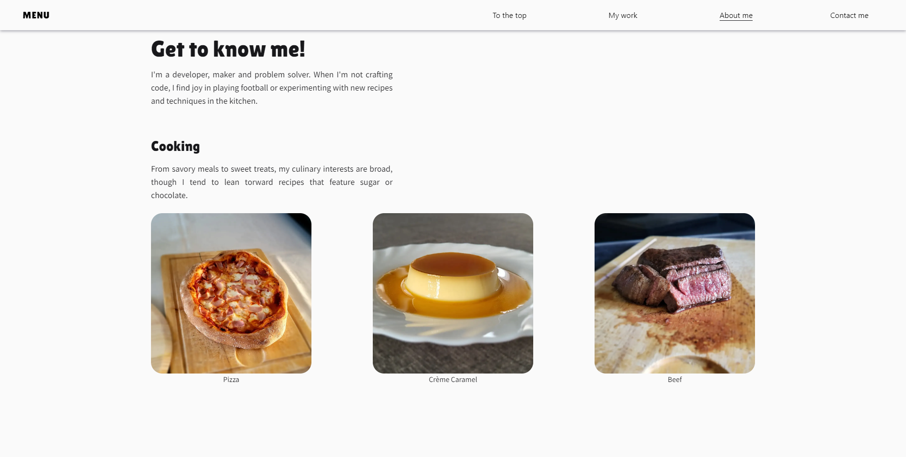

# franciszekczajka.me

> Personal portfolio website showcasing my work across cross-platform Flutter applications and full-stack Next.js web platforms.

## Table of Contents

- [Demo](#demo)
- [Site](#site)
- [Technologies Used](#technologies-used)
- [Setup](#setup)
- [Scripts](#scripts)
- [Acknowledgements](#acknowledgements)
- [Contact](#contact)

## Demo

> Working live demo is [_here_](https://www.franciszekczajka.me/).

## Site

### Landing page



### My work



### Who am I?



## Technologies Used

- Next.js - 13.5
- React - 18.2
- TypeScript - 4.9.5
- Tailwind CSS - 3.4
- React Toastify - 9.1.2
- Vitest - 2.1

## Setup

Install dependencies locally:

```bash
git clone https://github.com/fczajka/portfolio.git
cd portfolio
npm install
```

Copy `.env.example` to `.env.local` and configure your EmailJS server credentials for `POST /api/contact`:

```bash
cp .env.example .env.local
```

Start the development server:

```bash
npm run dev
```

Visit [http://localhost:3000](http://localhost:3000).

## Scripts

- `npm run dev` — Start local development server
- `npm run build` — Create production build
- `npm run start` — Serve production build
- `npm run lint` — Run Next.js ESLint checks
- `npm run typecheck` — Run TypeScript typechecking (`tsc --noEmit`)
- `npm test` — Run Vitest unit & hook tests
- `npm run format` / `npm run format:check` — Format or check code style with Prettier
- `npm run doctor` — Run React Doctor diagnostics

## Acknowledgements

This project was inspired by https://robbowen.digital/

## Contact

Created by [@fczajka](mailto:franekczajkaa@gmail.com) - feel free to contact me!
